<h1 align="center">Alt</h1>

<p align="center"><em>Learn from you, serve for you.</em></p>

<p align="center">
A self-hosted RSS reader that turns what you read into searchable, summarized,<br />
rediscoverable knowledge, using models that run on your own machine.
</p>

<p align="center">
  <a href="https://github.com/Kaikei-e/Alt/actions/workflows/e2e-playwright.yml"></a>
  <a href="https://github.com/Kaikei-e/Alt/actions/workflows/proto-contract.yaml"></a>
  <a href="https://github.com/Kaikei-e/Alt/actions/workflows/backend-go.yaml"></a>
  <a href="https://github.com/Kaikei-e/Alt/actions/workflows/alt-frontend-sv.yml"></a>
  <a href="https://github.com/Kaikei-e/Alt/actions/workflows/docker-build.yaml"></a>
  <br />
  <sub><a href="https://github.com/Kaikei-e/Alt/actions">All workflows</a></sub>
</p>

<p align="center">
  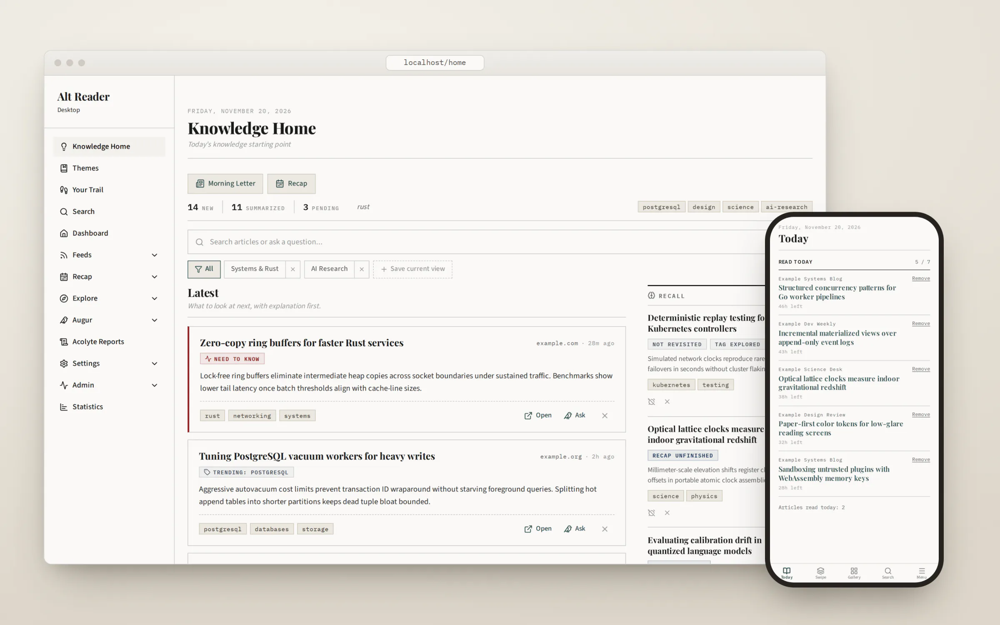
</p>

<p align="center">
  <a href="#what-alt-does">What Alt does</a> ·
  <a href="#screens">Screens</a> ·
  <a href="#quick-start">Quick start</a> ·
  <a href="#how-it-works">How it works</a> ·
  <a href="#repository-map">Repository map</a> ·
  <a href="#development">Development</a> ·
  <a href="#documentation">Documentation</a>
</p>

## What Alt does

Most RSS readers stop at the article list. Alt keeps going: it summarizes and tags what arrives, lets you search and question your own reading history, and brings back the things worth a second look.

Storage, search and the language models all run on your machine under Docker Compose, so no cloud LLM key is needed. Optional integrations (Inoreader sync, alert push) are off by default.

| Stage | What you get | Where in the app |
| :--- | :--- | :--- |
| **Collect** | Subscribe by RSS link or OPML import. Feeds are polled every hour, with daily inflow caps. | Manage Feed Links |
| **Read** | A short Today queue, swipe triage on your phone, a visual gallery and a quiet reader. Favorites and history keep what you finished. | Today · Swipe · Visual Preview · Feeds · Favorites · Read History |
| **Digest** | A summary and tags for each article, a 3-Day Recap by genre, cross-source Topic Cards, a daily Morning Letter, and Themes that grow from what you read. | 3-Day Recap · Topic Cards · Morning Letter · Themes |
| **Ask** | Search across articles, recaps and tags. **Ask Augur** answers questions from your own articles, with citations. **Acolyte** writes long, versioned reports with sources. | Search · Ask Augur · Acolyte Reports |
| **Revisit** | **Knowledge Home** resurfaces items and says why. **Your Trail** traces what you read and proposes next steps. **Tag Verse** maps your tags in 3D. | Knowledge Home · Your Trail · Tag Trail · Tag Verse |
| **Operate** | Web Push notifications, statistics, recap job status, and admin consoles for projections and system health. | Notifications · Dashboard · Statistics · Job Status · Admin |

## Screens

<table>
  <tr>
    <td width="50%" align="center">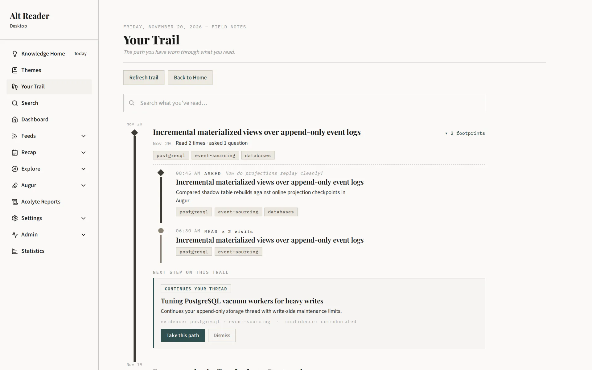<br /><sub><b>Your Trail</b> · what you read, and where it could lead</sub></td>
    <td width="50%" align="center">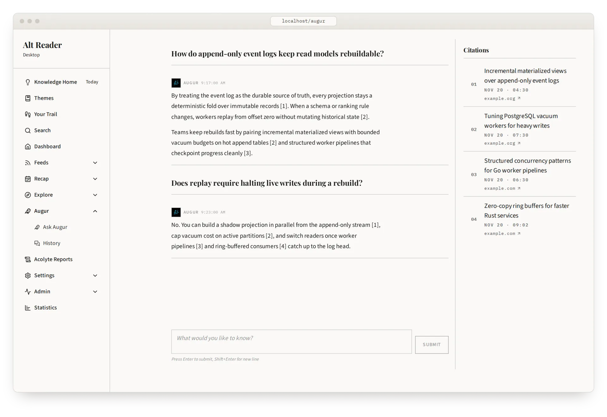<br /><sub><b>Ask Augur</b> · answers from your own articles, with citations</sub></td>
  </tr>
  <tr>
    <td width="50%" align="center">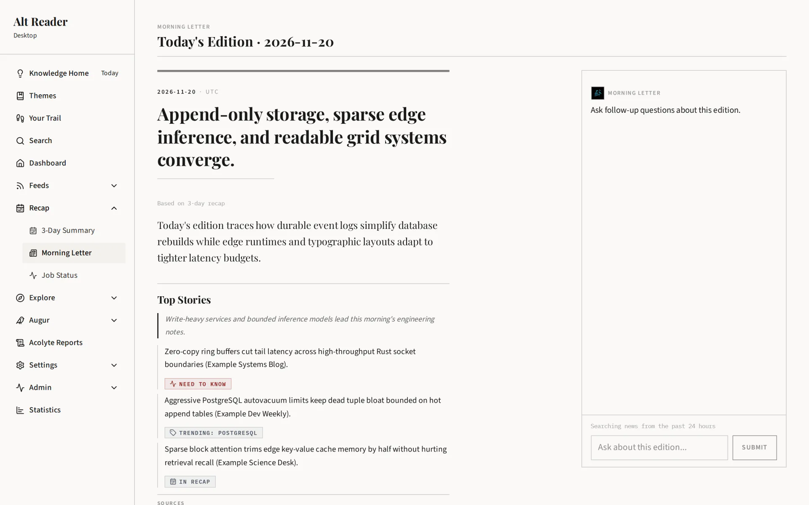<br /><sub><b>Morning Letter</b> · a daily briefing you can question</sub></td>
    <td width="50%" align="center">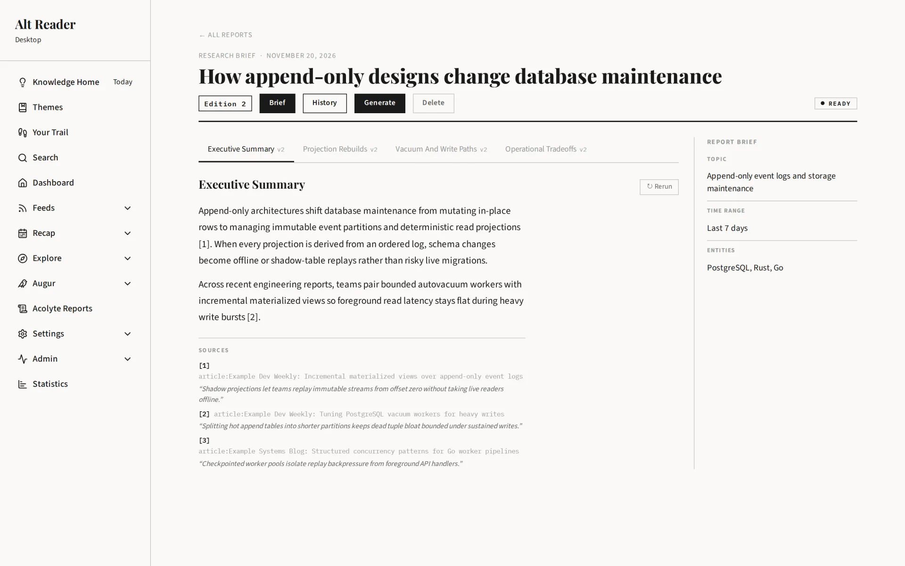<br /><sub><b>Acolyte</b> · long-form reports, versioned and sourced</sub></td>
  </tr>
</table>

<table>
  <tr>
    <td width="33%" align="center">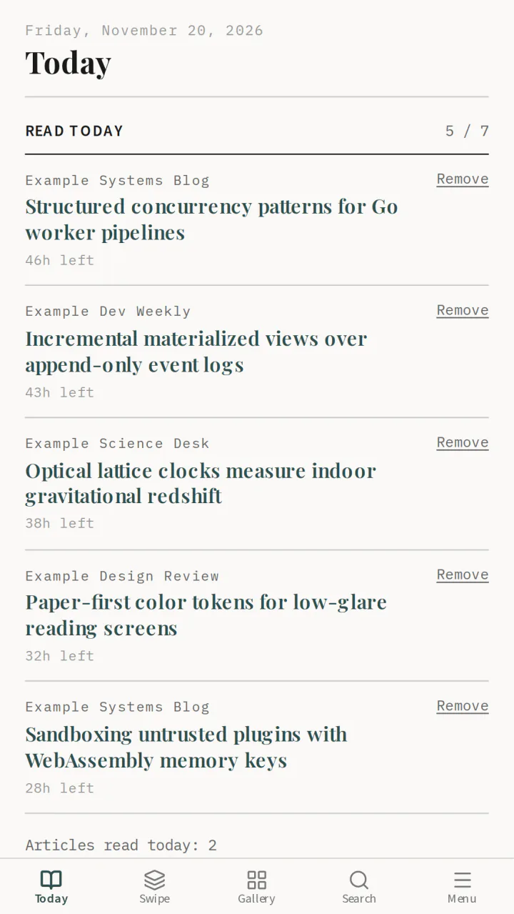<br /><sub><b>Today</b> · a short queue, not a backlog</sub></td>
    <td width="33%" align="center">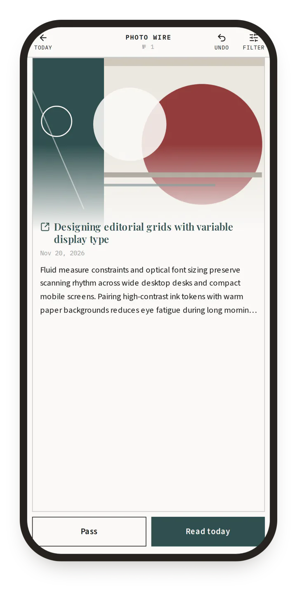<br /><sub><b>Swipe</b> · triage one card at a time</sub></td>
    <td width="33%" align="center">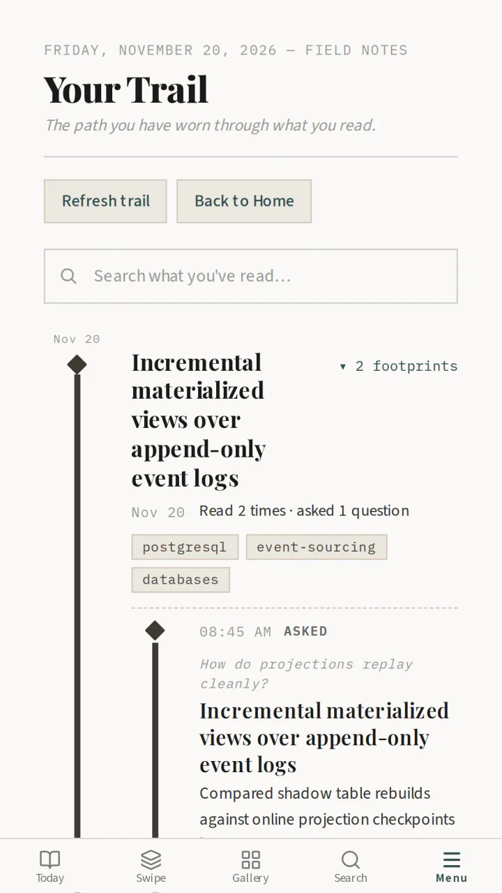<br /><sub><b>Your Trail</b> · the same trail in your pocket</sub></td>
  </tr>
</table>

Every screenshot is the real UI rendered with synthetic fixtures and composed into browser and phone frames. Regenerate them with `bun run capture:readme` in [`alt-frontend-sv/`](alt-frontend-sv); the export step needs `cwebp` on your PATH.

## Quick start

You need:

- Docker with the Compose v2 plugin
- Go 1.27 or newer, to build the `altctl` CLI
- Optional: an NVIDIA GPU for the `ai`, `rag`, `recap` and `tts` stacks
- On Linux hosts with AppArmor: load the `alt-docker-postgres` profile before the first start, as described in [docs/runbooks/postgres-apparmor.md](docs/runbooks/postgres-apparmor.md)

```bash
git clone https://github.com/Kaikei-e/Alt.git && cd Alt

# 1. Build the CLI and put it on your PATH
(cd altctl && go build -o altctl . && sudo mv altctl /usr/local/bin/)

# 2. Create .env and secrets/ (keeps anything that already exists)
altctl init

# 3. Start the reader; dependencies such as db and auth start automatically
altctl up core workers bff
```

Open <http://localhost/> and create an account. To check the stack from a terminal:

```bash
altctl status
curl -fsS http://localhost:8080/readyz     # plecto-proxy (edge)
curl -fsS http://localhost:9000/v1/health  # alt-backend
curl -fsS http://localhost:9250/health     # alt-butterfly-facade
curl -fsS http://localhost:7700/health     # Meilisearch
```

Add capabilities one stack at a time with `altctl up <stack>`:

| Stack | Adds | GPU |
| :--- | :--- | :--- |
| `ai` | Article summaries: `pre-processor`, `news-creator` and a local Ollama runtime | Yes |
| `rag` | Ask Augur: `rag-orchestrator`, pgvector, a local embedder and reranker | Yes |
| `recap` | 3-Day Recap, Topic Cards, Morning Letter and Themes | Yes |
| `acolyte` | Acolyte reports (uses the `ai` stack for generation) | No |
| `logging` | Structured logs from every container into ClickHouse | No |
| `observability` | Prometheus, Alertmanager, Grafana and cAdvisor | No |
| `tts` | Japanese text-to-speech for listening to articles | Yes |

`altctl list` shows every stack, `altctl down` stops them, and `altctl down --volumes` also deletes the data. The full CLI is described in [altctl/README.md](altctl/README.md).

## How it works

Alt is a set of small services on one machine, started by Docker Compose. A request enters at the edge, passes through the web app and its backend-for-frontend, and reaches the core platform. Everything slow, such as summarizing, tagging, indexing and report writing, happens in the background and reports back through events.

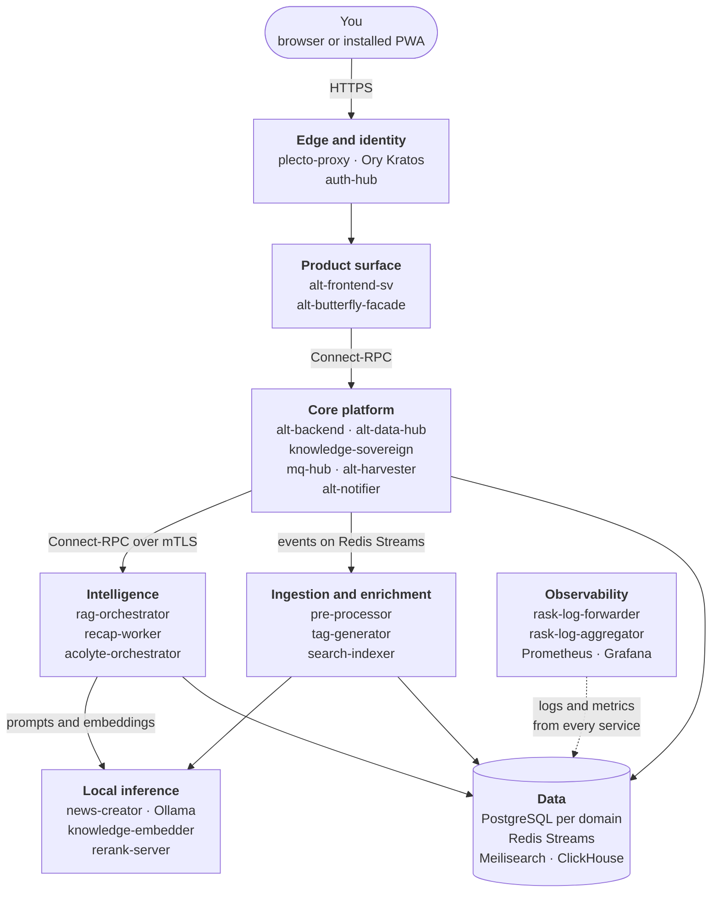

The map leaves out connection poolers, the internal certificate authority, database migrators and per-service log forwarders. Four ideas hold it together:

- **Local-first inference.** Summaries, embeddings, reranking and search run on your hardware through `news-creator` and Ollama.
- **Append-first knowledge.** What happens is appended to an event log in `knowledge-sovereign`. Screens such as Knowledge Home and Your Trail are read models that can be dropped and rebuilt from that log.
- **Typed contracts.** Services follow Clean Architecture (`Handler → Usecase → Port → Gateway → Driver`) and talk over Connect-RPC and Protobuf, checked by Pact contract tests.
- **Isolated by default.** Services authenticate each other with mutual TLS, each domain keeps its own database, and the article database is reached only through `alt-data-hub`.

### Life of an article

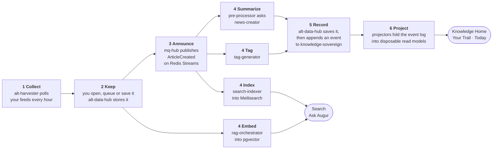

### Asking a question

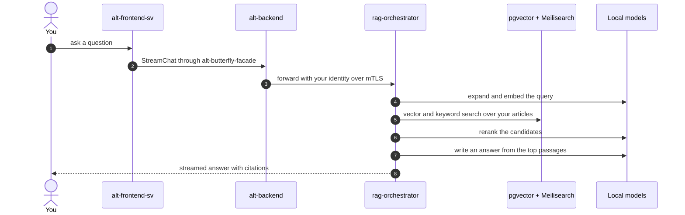

Ports, health endpoints and the full dependency graph are in [docs/services/MICROSERVICES.md](docs/services/MICROSERVICES.md).

## Repository map

Each top-level directory is one service or tool. **Stack** is the `altctl` stack that runs it.

**Edge and product surface**

| Directory | Stack | Tech | Role |
| :--- | :--- | :--- | :--- |
| [`plecto/`](plecto) | `core` | Rust, WASM | Routing manifest and WASM filter for the `plecto-proxy` edge |
| [`auth-hub/`](auth-hub) | `auth` | Go | Turns an Ory Kratos session into a signed internal token |
| [`alt-frontend-sv/`](alt-frontend-sv) | `core` | SvelteKit 3, Svelte 5, Tailwind v4, Bun | The web app and installable PWA |
| [`alt-butterfly-facade/`](alt-butterfly-facade) | `bff` | Go | Backend for frontend: one Connect-RPC entry for the web app |

**Core platform**

| Directory | Stack | Tech | Role |
| :--- | :--- | :--- | :--- |
| [`alt-backend/`](alt-backend) | `core` | Go, Connect-RPC | One Go module, four binaries: `alt-backend` (API), `alt-harvester` (scheduled jobs), `alt-notifier` (Web Push), `alt-data-hub` (article database owner) |
| [`knowledge-sovereign/`](knowledge-sovereign) | `sovereign` | Go | Append-only event log and the Knowledge Home, Trail and Reading projectors |
| [`mq-hub/`](mq-hub) | `mq` | Go, Redis Streams | Event broker that publishes to Redis Streams |

**Ingestion and enrichment**

| Directory | Stack | Tech | Role |
| :--- | :--- | :--- | :--- |
| [`pre-processor/`](pre-processor) | `ai` | Go | Queues articles for summarization and checks summary quality |
| [`tag-generator/`](tag-generator) | `workers` | Python, FastAPI | Extracts tags from articles with ML models |
| [`search-indexer/`](search-indexer) | `workers` | Go | Indexes articles and recaps into Meilisearch and serves search |
| [`pre-processor-sidecar/`](pre-processor-sidecar) | `workers` | Go | Optional Inoreader sync scheduler, disabled by default |
| [`auth-token-manager/`](auth-token-manager) | `workers` | Deno | Refreshes the OAuth token used by the optional Inoreader sync |

**Intelligence**

| Directory | Stack | Tech | Role |
| :--- | :--- | :--- | :--- |
| [`rag-orchestrator/`](rag-orchestrator) | `rag` | Go, pgvector | Retrieval and answer pipeline behind Ask Augur |
| [`recap-worker/`](recap-worker) | `recap` | Rust, Tokio | Builds the 3-Day Recap, Topic Cards, Morning Letter and Themes |
| [`recap-subworker/`](recap-subworker) | `recap` | Python, FastAPI | Clustering, classification and evidence checks for `recap-worker` |
| [`recap-evaluator/`](recap-evaluator) | `recap` | Python, FastAPI | Scores recap quality on a schedule |
| [`dashboard/`](dashboard) | `recap` | Python, Streamlit | Operator dashboard for recap evaluation |
| [`acolyte-orchestrator/`](acolyte-orchestrator) | `acolyte` | Python, LangGraph | Plans, gathers, writes and revises Acolyte reports |

**Local inference**

| Directory | Stack | Tech | Role |
| :--- | :--- | :--- | :--- |
| [`news-creator/`](news-creator) | `ai` | Python, FastAPI, Ollama | Priority-queued LLM gateway in front of a local Ollama runtime |
| [`knowledge-embedder/`](knowledge-embedder) | `rag` | Ollama | Embedding runtime serving `bge-m3` |
| [`rerank-server/`](rerank-server) | `rag` | Python, ONNX | Cross-encoder reranker for retrieval results |
| [`knowledge-augur/`](knowledge-augur) | separate | Ollama | Standalone Ollama runtime with RAG Modelfiles, run from `compose.augur.yaml` |
| [`tts-speaker/`](tts-speaker) | `tts` | Python, Connect-RPC | Streaming text-to-speech gateway |
| [`irodori-tts/`](irodori-tts) | `tts` | Python, CUDA | Japanese text-to-speech inference container |

**Observability**

| Directory | Stack | Tech | Role |
| :--- | :--- | :--- | :--- |
| [`rask-log-forwarder/`](rask-log-forwarder) | `logging` | Rust | Tails container logs and forwards them in batches |
| [`rask-log-aggregator/`](rask-log-aggregator) | `logging` | Rust, Axum | Receives logs and OpenTelemetry data and writes them to ClickHouse |

**Tooling**

| Directory | Stack | Tech | Role |
| :--- | :--- | :--- | :--- |
| [`altctl/`](altctl) | CLI | Go | Starts, stops, inspects and backs up the Compose stacks |
| [`pki-agent/`](pki-agent) | CLI | Go | Provisioning helpers for the internal certificate authority |
| [`alt-perf/`](alt-perf) | `perf` | Deno, k6 | Core Web Vitals measurement and load tests |
| [`metrics/`](metrics) | CLI | Python | Health reports generated from the ClickHouse logs |
| [`monitors/`](monitors) | CLI | Python | Live resource monitor for recap jobs |

Shared material lives in [`compose/`](compose) (stack definitions), [`proto/`](proto) (Protobuf contracts), [`pacts/`](pacts) (consumer contracts), [`docs/`](docs), and the `*-migration-atlas/` and [`migrations-atlas/`](migrations-atlas) directories (database migrations). [`feed-validator/`](feed-validator), [`news-pulser/`](news-pulser), [`news-vigil/`](news-vigil) and [`x-prototype/`](x-prototype) are experiments and are not part of the running system.

## Development

Four rules apply everywhere:

1. **Test first.** Write the failing test, make it pass, then refactor.
2. **Be polite to the outside world.** Leave at least 5 seconds between calls to an external API.
3. **Rebuild compiled services.** After changing Go, Rust or TypeScript, run `altctl rebuild <service>` or `docker compose up --build`.
4. **No secrets in code.** Use `.env` and Docker secrets.

| Language | Version | Test | Lint and types |
| :--- | :--- | :--- | :--- |
| Go | 1.27 | `go test ./...` | `gofmt -l .` and `go vet ./...` |
| Python | 3.14 | `uv run pytest` | `uv run ruff check` and `uv run pyrefly check` |
| Rust | 1.99, 2024 edition | `cargo test` | `cargo fmt --check` and `cargo clippy` |
| TypeScript | SvelteKit 3 on Bun | `bun run test` | `bun run lint` and `bun run check` |
| Deno | 2 | `deno test` | `deno lint` and `deno check` |

Each service has its own `CLAUDE.md` with service-specific commands and rules. Read it before changing that service.

## Documentation

| If you want to… | Read |
| :--- | :--- |
| Look up a service, its ports and its dependencies | [docs/services/MICROSERVICES.md](docs/services/MICROSERVICES.md) |
| Learn the project vocabulary | [docs/glossary/ubiquitous-language.md](docs/glossary/ubiquitous-language.md) |
| Understand a feature in depth | [Knowledge Home](docs/features/knowledge-home/README.md) · [Acolyte](docs/features/acolyte/README.md) |
| Know why something was built this way | [docs/ADR/](docs/ADR) |
| Operate or recover a running system | [docs/runbooks/README.md](docs/runbooks/README.md) |
| Use the CLI | [altctl/README.md](altctl/README.md) |
| Write tests the way the project does | [docs/testing-strategy.md](docs/testing-strategy.md) |
| Learn from past incidents and design shifts | [Postmortems](docs/postmortems/README.md) · [Case studies](docs/case-studies/README.md) |
| Contribute code, by hand or with an agent | [CLAUDE.md](CLAUDE.md) |

## Acknowledgments

Alt is built on the work of other open-source projects. A few of them shape it so deeply that they are named here, with thanks to the people who maintain them.

Alt keeps its articles and its knowledge event log in [PostgreSQL](https://www.postgresql.org/). [pgvector](https://github.com/pgvector/pgvector) lets Ask Augur search your reading by meaning, and [Meilisearch](https://www.meilisearch.com/) powers search across articles, recaps and tags. Events travel between services on [Redis](https://redis.io/) Streams, and logs are kept in [ClickHouse](https://clickhouse.com/).

Alt needs no cloud LLM key because [Ollama](https://ollama.com/), and [llama.cpp](https://github.com/ggml-org/llama.cpp) underneath it, run the models on your own machine. The models are the work of others too. [Gemma 4](https://huggingface.co/google/gemma-4-E4B-it-qat-q4_0-gguf) from Google writes the summaries and answers. [BGE-M3](https://huggingface.co/BAAI/bge-m3) from BAAI produces the embeddings. The [Ruri v3 reranker](https://huggingface.co/cl-nagoya/ruri-v3-reranker-310m) from Nagoya University orders what retrieval finds. [Irodori-TTS](https://github.com/Aratako/Irodori-TTS) by Aratako reads articles aloud in Japanese.

Japanese text has no spaces between words. To split it, Alt relies on [MeCab](https://taku910.github.io/mecab/) through [fugashi](https://github.com/polm/fugashi) with the [UniDic](https://clrd.ninjal.ac.jp/unidic/) dictionary from NINJAL, on [Kagome](https://github.com/ikawaha/kagome) and on [Lindera](https://github.com/lindera/lindera).

Sign-in is handled by [Ory Kratos](https://github.com/ory/kratos). The internal certificate authority that lets services trust each other is [step-ca](https://github.com/smallstep/certificates) from Smallstep. Services talk over [Connect](https://connectrpc.com/), and [Pact](https://pact.io/) checks that their contracts still hold.

Alt is also starting to adopt [Tauto](https://github.com/Hihaheho/tauto) from Hihaheho, a minimal language for AI to build and prove correct software.

Beyond these, Alt depends on many libraries from the Go, Rust, Python and Svelte ecosystems. They are listed in each service's `go.mod`, `Cargo.toml`, `pyproject.toml` or `package.json`. Every project and model is distributed under its own license. If Alt uses your work and credits it wrongly or not at all, please open an issue.

## License

Alt is licensed under the [Apache License 2.0](LICENSE).
